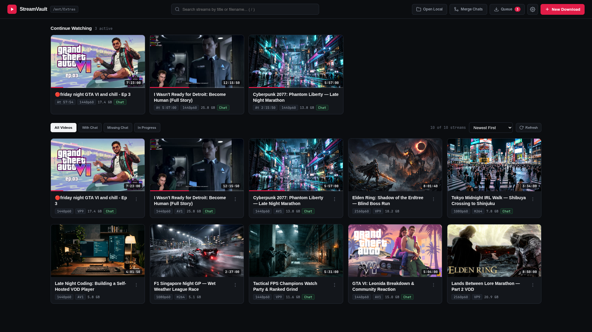
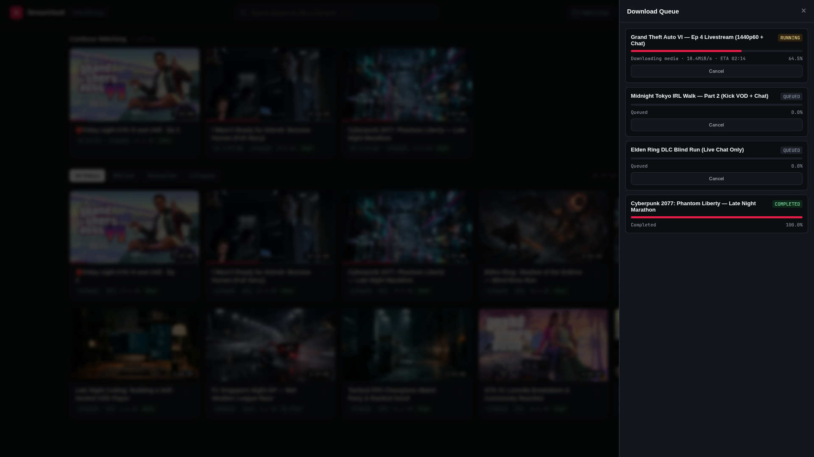
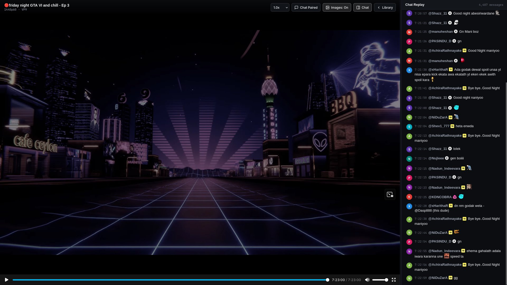

<div align="center">

# StreamVault — Offline Stream Player

**Download and watch YouTube & Kick livestreams offline with synchronized live chat replay—the way they actually aired.**


<br/><br/>



</div>

---

## Why StreamVault?

When you download a livestream VOD to watch offline, you usually lose half the experience: **the live chat.** Standard media players like VLC or mpv only play the video, and even if you grab chat logs separately, there is no easy way to watch them together in sync.

**StreamVault** solves this end-to-end. It downloads both the stream and its full live chat replay (or fetches **chat-only** for streams you already have), pairs or merges split chats (even cross-platform like a YouTube VOD + Kick chat), and plays everything back in a theater view with real-time synchronized chat completely offline.

### Key Features

- **YouTube-Style Video Library:** Automatically scans your configured `DOWNLOAD_DIR`, generates cached `480px` thumbnails (`ffmpeg`) and stream metadata (`ffprobe`), tracks resume positions, and surfaces a **Continue Watching** shelf.
- **Built-In Web Downloader & Queue:** Paste any **YouTube** or **Kick** URL to probe available qualities and download **Video + Live Chat**, **Chat Only**, or **Video Only** directly from the dashboard with live speed, ETA, percentage progress, and cancellation.
- **Strict Drive Isolation:** All media files, `.part` fragments, `TMPDIR` temp files, thumbnails, metadata, and watch history stay strictly inside `DOWNLOAD_DIR` (`<DOWNLOAD_DIR>/.osp-cache/`)—never cluttering your OS/NVMe drive.
- **Theater Watch View:** Smooth `HTTP 206 Partial Content` byte-range streaming for instant seeking on multi-hour 4K/1440p VODs, auto-hiding studio top HUD, playback speed control, and server-synced auto-resume.
- **Synchronized & Mergeable Chat Replay:** Supports raw YouTube `.live_chat.json` and Kick `.chat.json`, 1-click chat pairing, **multi-part chat merging** (e.g. combining split Kick VOD chats onto a full YouTube recording), timestamp click-to-seek, and an **Images: Off/On** toggle with automatic offline circuit-breaking.

### Download Queue

Queue multiple YouTube or Kick downloads (Video + Chat, Chat Only, or Video Only) and track live speed, ETA, and progress from the dashboard:



### Theater Player & Synchronized Chat Replay

Watch streams in a distraction-free theater view with an auto-hiding top bar, playback speed controls, server-synced resume, and real-time chat replay:



---

## Quick Start

### 1. Prerequisites
- **Python 3.9+**
- **`ffmpeg` & `ffprobe`** on `PATH`
- **`yt-dlp`** (`pip install -r requirements.txt`)

```bash
git clone <your-repo-url> offline-stream-player
cd offline-stream-player
pip install -r requirements.txt
```

### 2. Configure `.env`
Copy `.env.example` to `.env` (gitignored) and set your target storage path:

```bash
cp .env.example .env
```

> **Note:** StreamVault reads `.env` directly with no hidden fallback defaults—if `.env` or a required key is missing, startup reports the exact missing variable.

### 3. Launch
**Linux / macOS:**
```bash
bash start.sh
```
**Windows:**
```bat
start.bat
```
*(Or run `python app.py` directly on any OS.)*

Open **`http://127.0.0.1:8765`** in your browser.

---

## Configuration Reference (`.env`)

| Variable | Example | Description |
| :--- | :--- | :--- |
| `DOWNLOAD_DIR` | `/mnt/Extras` | Root folder for all downloads, temp files, and `.osp-cache/` |
| `HOST` | `127.0.0.1` | Bind address for the HTTP server |
| `PORT` | `8765` | HTTP server port |
| `BROWSER` | `zen-browser` | Browser binary to launch on `start.sh` (optional if `AUTO_OPEN_BROWSER=false`) |
| `AUTO_OPEN_BROWSER` | `true` | Auto-open browser when starting via `start.sh` |
| `YT_QUALITY` | `bestvideo+bestaudio/best` | Default `yt-dlp` format selector (also editable via Settings dropdown) |
| `YT_FORMAT` | `mkv` | Default output container (`mkv`, `mp4`, `webm`) |
| `YT_CONCURRENT_FRAGMENTS` | `4` | `yt-dlp -N` concurrent fragment downloads |
| `KICK_CHAT_WORKERS` | `1` | Worker count for Kick chat history pagination |
| `KICK_REQUEST_DELAY` | `0.25` | Minimum delay (seconds) between Kick chat API requests |
| `THUMBNAIL_SEEK_SEC` | `120` | Seek timestamp (seconds) used for `ffmpeg` thumbnail extraction |

You can edit all of these directly from the **Settings** modal inside the web UI.

---

## Project Structure

```text
.
├── app.py              # Entrypoint (loads strict .env config & starts server)
├── start.sh            # Linux/macOS launcher (server + browser + NVIDIA VA-API env)
├── start.bat           # Windows launcher (reads .env, opens browser, runs app.py)
├── download_yt.sh      # Optional CLI wrapper -> python3 -m osp.downloader youtube
├── download_kick.sh    # Optional CLI wrapper -> python3 -m osp.downloader kick
├── .env.example        # Documented environment template
├── osp/
│   ├── config.py       # Strict .env parser & writer
│   ├── library.py      # Top-level media scanner, ffprobe/ffmpeg cache, history & pairings
│   ├── downloader.py   # Unified YouTube & Kick downloader + background job queue
│   ├── chat.py         # Chat parser & multi-part chat merger
│   └── server.py       # ThreadingHTTPServer (206 range streaming + REST API)
└── static/
    ├── index.html      # Library Dashboard, Theater Watch View & Modals
    ├── styles.css      # Dark studio UI styling
    ├── app.js          # Library, Queue, Merge & Settings controller
    ├── watch.js        # Theater player, speed, HUD auto-hide & resume sync
    └── chat.js         # Synced chat renderer & external image circuit breaker
```

---

## Keyboard Shortcuts (Watch View)

| Key | Action |
| :--- | :--- |
| `Space` / `k` | Play / Pause |
| `Left` / `Right` | Seek -5s / +5s |
| `j` / `l` | Seek -10s / +10s |
| `[` / `]` | Decrease / Increase playback speed |
| `m` | Mute / Unmute |
| `f` | Toggle Fullscreen |
| `c` | Show / Hide Chat Sidebar |

## CLI Usage (Optional)

```bash
bash download_yt.sh "<YOUTUBE_URL>" [DESTINATION_DIR] [--chat-only]
bash download_kick.sh "<KICK_URL>" [DESTINATION_DIR] [--chat-only]
```

## License

Licensed under the [MIT License](LICENSE).
